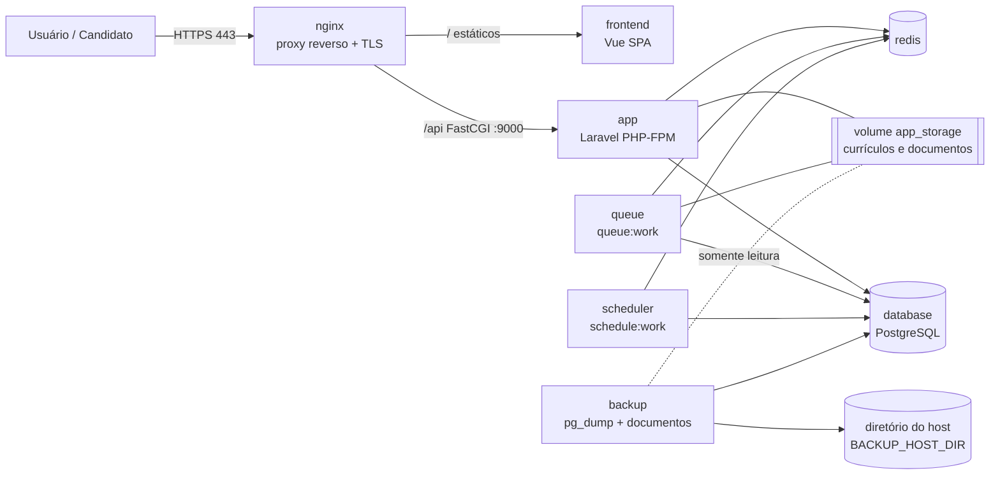
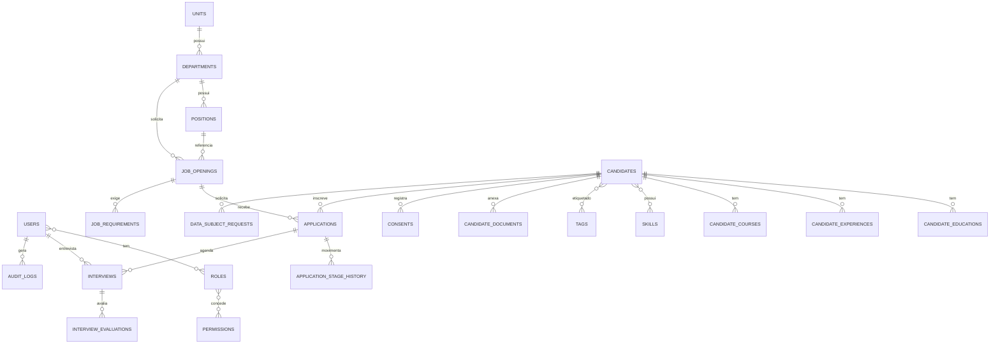

# CEOF TALENT — Fase 1: Planejamento e Arquitetura

> Sistema profissional de Banco de Talentos e Gestão de Recrutamento e Seleção.
> Documento vivo: atualizado ao final de cada fase (ver [Roadmap](#11-roadmap-e-status-das-fases)).

## 1. Visão geral

O CEOF TALENT centraliza todo o ciclo de recrutamento: captação de candidatos (portal público
e cadastro interno), armazenamento seguro de currículos, gestão de vagas, triagem, processos
seletivos em Kanban, entrevistas e avaliações, banco de talentos, indicadores e relatórios,
com controle de acesso por perfil e conformidade com a LGPD.

Princípios que orientam todas as decisões:

1. **Funcional de verdade**: toda tela é integrada ao banco real, com validação, regras de
   negócio, permissões e tratamento de erros. Nada de dados fictícios simulando funcionalidade.
2. **Docker em tudo**: nenhum serviço depende de instalação manual no host.
3. **Segurança e privacidade por padrão**: dados pessoais são o ativo central do sistema.
4. **Pronto para a nuvem desde o início**: só variáveis de ambiente mudam entre ambientes.
5. **Entrega incremental validada**: cada fase termina testada e documentada.

## 2. Stack e versões fixadas

| Camada | Tecnologia | Versão | Observação |
|---|---|---|---|
| Linguagem backend | PHP | 8.3 (Ubuntu 24.04 LTS) | correções de segurança mantidas pela Canonical |
| Framework | Laravel | 13.x | API REST, Sanctum, filas e agendador |
| Autenticação | Laravel Sanctum | (Fase 3) | sessão por cookie na mesma origem do SPA |
| Frontend | Vue.js + TypeScript | Vue 3.5, TS 6 | Composition API, `<script setup>` |
| Build frontend | Vite | 8.x | |
| Estilo | Tailwind CSS | 4.x | tema azul/branco/cinza corporativo |
| Estado / rotas | Pinia / Vue Router | 4.x | |
| Banco | PostgreSQL | 17.10 | extensões `pg_trgm`, `unaccent`, `citext` |
| Cache, sessões, filas | Redis | 7.4.12 | AOF ligado, `noeviction` |
| Web / proxy | Nginx | 1.30.8 (estável) | TLS, cabeçalhos de segurança, rate limit |
| Node (build) | Node.js | 22.23.5 LTS | apenas em build/dev |
| Composer | Composer | 2.9.8 | apenas em build/dev |
| Orquestração | Docker Engine + Compose | Compose v2+ | |

**Nenhuma imagem usa a tag `latest`.** As tags das imagens base estão fixadas nos Dockerfiles
(`ARG ..._IMAGE`) e nos arquivos Compose. Atualizações de versão são feitas deliberadamente,
testadas com `docker/scripts/test-infrastructure.sh` e registradas neste documento.

### 2.1 Por que Ubuntu 24.04 para a imagem PHP (e não `php:fpm-alpine`)

- PHP 8.3 com extensões pré-compiladas (`pgsql`, `redis`, `intl`, `gd`, `zip`…): o build não
  compila nada, é mais rápido e reprodutível.
- Suporte de segurança LTS até 2029 via `apt` (patches de PHP e OpenSSL sem trocar de imagem).
- Ferramentas que serão necessárias na Fase 7.9 (leitura de PDF/DOCX e OCR: `poppler-utils`,
  `tesseract-ocr` com idioma `por`) estão disponíveis como pacotes oficiais.

## 3. Arquitetura de containers



| Serviço | Responsabilidade | Exposto ao host? | Usuário |
|---|---|---|---|
| `nginx` | entrada única, TLS, roteamento `/api` → PHP, `/` → SPA, rate limit | sim (80/443) | `nginx` (101) |
| `frontend` | SPA Vue (dev: Vite com HMR; prod: estáticos em Nginx interno) | não | `node`/`nginx` |
| `app` | API Laravel em PHP-FPM; executa migrations na subida | não | `www-data` |
| `queue` | jobs assíncronos (e-mails, extração de currículos, relatórios pesados) | não | `www-data` |
| `scheduler` | tarefas programadas (retenção LGPD, lembretes de entrevista, limpeza) | não | `www-data` |
| `database` | PostgreSQL 17 | **não em produção** (dev: só `127.0.0.1`) | `postgres` |
| `redis` | cache, sessões e filas | não | `redis` |
| `backup` | backup diário programado + backup/verificação manual | não | root (somente leitura nos dados) |
| `restore` | restauração sob demanda (profile `tools`) | não | root |

Redes: `edge` (tráfego HTTP e saída para internet) e `internal` (banco, Redis, filas). Em
produção `internal` é `internal: true`, ou seja, banco e Redis não têm rota para fora.

Detalhes operacionais: [docs/02-infraestrutura-docker.md](02-infraestrutura-docker.md).

## 4. Estrutura de diretórios

```
ceof-talent/
├── backend/                 # Laravel 13 (API REST)
├── frontend/                # Vue 3 + TypeScript + Vite + Tailwind
├── docker/
│   ├── php/                 # Dockerfile do backend, php.ini, pool FPM, entrypoint, healthcheck
│   ├── frontend/            # Dockerfile do frontend, Nginx interno do SPA
│   ├── nginx/               # Dockerfile, nginx.conf, templates dev/prod, certificados (não versionados)
│   ├── postgres/            # postgresql.conf, scripts de inicialização
│   ├── redis/               # redis.conf
│   ├── backup/              # Dockerfile e scripts de backup/restauração/verificação
│   └── scripts/             # utilitários executados no host (segredos, TLS, teste de infraestrutura)
├── backups/                 # destino padrão dos backups (não versionado)
├── docs/                    # documentação técnica e manuais
├── docker-compose.yml       # desenvolvimento
├── docker-compose.prod.yml  # produção
├── .dockerignore
├── .env.example
└── README.md
```

Ajustes em relação à sugestão original e motivo:

- **Dockerfiles ficam em `docker/<serviço>/Dockerfile`** em vez de um `Dockerfile` na raiz: o
  projeto tem quatro imagens diferentes (backend, frontend, nginx, backup). O contexto de build é
  a raiz do repositório e um único `.dockerignore` controla o que entra nas imagens.
- **Não há `storage/` na raiz**: os documentos ficam no volume Docker `app_storage` (produção)
  ou em `backend/storage/app` (desenvolvimento), nunca dentro da imagem.

## 5. Arquitetura do backend

API REST stateless do ponto de vista de domínio, organizada por **módulos de domínio**:

```
backend/app/
├── Domain/
│   ├── Candidates/          # candidatos, currículos, formação, experiências, competências
│   ├── Talent/              # banco de talentos: busca, favoritos, etiquetas, duplicidades
│   ├── Jobs/                # vagas, aprovação, publicação
│   ├── Recruitment/         # processos seletivos, etapas, movimentações (Kanban)
│   ├── Interviews/          # entrevistas, critérios, pareceres
│   ├── Organization/        # unidades, departamentos, cargos
│   ├── Identity/            # usuários, perfis, permissões
│   ├── Privacy/             # LGPD: consentimentos, bases legais, solicitações de titulares, retenção
│   ├── Audit/               # trilha de auditoria e logs de acesso
│   ├── Reporting/           # indicadores, dashboard, exportações
│   └── Intelligence/        # contratos para extração/IA (Fase 7.9)
│       └── <Módulo>/{Actions,Services,Events,Jobs,Enums,Data}
├── Models/                  # modelos Eloquent (convenção Laravel; um por tabela)
├── Policies/                # uma Policy por modelo (descoberta automática)
├── Http/
│   ├── Controllers/Api/V1/<Módulo>/   # finos: validam (Form Request), autorizam, delegam à Action
│   ├── Requests/<Módulo>/          # Form Requests (validação + autorização básica)
│   └── Resources/<Módulo>/         # API Resources (formato de saída, sem vazar campos sensíveis)
└── Support/                         # utilitários transversais (ex.: Health)
```

> Ajuste feito na Fase 3: os modelos Eloquent ficam em `app/Models` e as Policies em
> `app/Policies` (descoberta automática do Laravel). `app/Domain/<Módulo>` reúne Actions,
> Enums e serviços de cada módulo.

Regras de implementação:

- **Controllers** não contêm regra de negócio: `FormRequest` → `Policy` → `Action` → `Resource`.
- **Actions** (uma operação de negócio por classe, ex.: `MoveApplicationToStage`) são
  transacionais, disparam eventos de domínio e registram auditoria.
- **Services** encapsulam lógica reutilizável ou integrações (armazenamento, extração de texto).
- **Policies e Gates** verificam permissões **sempre no backend**; o frontend apenas reflete.
- **Enums PHP** para estados (status de vaga, etapas do processo, perfis).
- **Eventos + filas** para efeitos colaterais (e-mail de confirmação, indexação, auditoria pesada).

### 5.1 Convenções da API

- Prefixo `/api/v1/...`; recursos no plural em inglês no código, rótulos em português na interface.
- JSON com `data`, `meta` (paginação) e `links`; paginação padrão de 15 itens, máximo 100.
- Filtros por query string (`?filter[status]=open&sort=-created_at&search=...`).
- Erros: `422` validação (`errors` por campo), `401`, `403`, `404`, `409` conflito de regra, `429`.
- Documentação OpenAPI gerada a partir do código (Fase 12) e publicada em `docs/api/`.

## 6. Arquitetura do frontend

```
frontend/src/
├── api/            # cliente HTTP (axios) e funções por recurso, tipadas
├── components/     # componentes reutilizáveis (tabela, modal, formulário, filtros, toast)
├── layouts/        # layout autenticado (menu lateral, topo, busca global) e layout público
├── modules/        # telas por domínio (candidates, jobs, recruitment, interviews, ...)
├── stores/         # Pinia (sessão do usuário, permissões, notificações)
├── router/         # rotas com guarda de autenticação e permissão
└── composables/    # lógica reutilizável (paginação, filtros, upload)
```

- SPA servida na **mesma origem** da API (Nginx), o que permite autenticação Sanctum por cookie
  `HttpOnly` + CSRF, sem tokens no `localStorage` e sem CORS.
- Portal público (Fase 9) usa o mesmo build com layout próprio em `/trabalhe-conosco`.

## 7. Modelo de dados (visão inicial)



Decisões de modelagem:

- Chaves primárias `bigint` internas + `uuid` público em entidades expostas (candidatos,
  documentos, vagas, inscrições), evitando enumeração de IDs.
- `citext` para e-mail; CPF opcional, armazenado normalizado e **criptografado** (cast
  `encrypted`), com hash determinístico separado para detectar duplicidade.
- Busca: colunas `tsvector` (dicionário `portuguese` + `unaccent`) com índice GIN e índices
  `pg_trgm` para nomes; detecção de duplicidade por e-mail, telefone, hash de CPF e similaridade.
- `soft deletes` em entidades de negócio; anonimização definitiva para atendimento à LGPD.
- Integridade referencial com `foreign keys` e `on delete restrict` por padrão; índices em
  todas as FKs e nos filtros frequentes (status, departamento, unidade, datas).
- Histórico imutável de movimentação (`application_stage_history`) e trilha de auditoria.

## 8. Perfis e permissões

Permissões granulares (`recurso.ação`) agrupadas em perfis. Matriz implementada na Fase 3 em `App\Domain\Identity\Enums\Role` (fonte da verdade; a tela **Perfis** mostra a matriz real):

| Permissão | Admin | Gestor RH | Analista RH | Recrutador | Gestor Depto. | Entrevistador |
|---|:-:|:-:|:-:|:-:|:-:|:-:|
| Usuários e perfis | ✔ | — | — | — | — | — |
| Unidades, departamentos e cargos | ✔ | ✔ | ver | ver | ver | — |
| Candidatos: ver | ✔ | ✔ | ✔ | ✔ | do seu depto.¹ | os entrevistados |
| Candidatos: criar/editar | ✔ | ✔ | ✔ | ✔ | — | — |
| Currículos: baixar | ✔ | ✔ | ✔ | ✔ | do seu depto.¹ | os entrevistados |
| Vagas: solicitar | ✔ | ✔ | ✔ | — | ✔ | — |
| Vagas: aprovar/publicar/encerrar | ✔ | ✔ | — | — | aprovar do seu depto. | — |
| Processos: mover etapas | ✔ | ✔ | ✔ | ✔ | ver | — |
| Contratação / reprovação final | ✔ | ✔ | — | — | ✔ (seu depto.) | — |
| Entrevistas: agendar | ✔ | ✔ | ✔ | ✔ | ✔ | — |
| Entrevistas: registrar parecer | ✔ | ✔ | ✔ | ✔ | ✔ | as suas |
| Dashboard e relatórios | ✔ | ✔ | ✔ | parcial | do seu depto. | — |
| LGPD: solicitações de titulares, retenção | ✔ | ✔ | — | — | — | — |
| Auditoria | ✔ | ver | — | — | — | — |

¹ apenas candidatos inscritos em vagas do próprio departamento.

Toda verificação acontece em **Policies/Gates no backend** e é coberta por testes de permissão.

## 9. Processo seletivo

Etapas padrão: `Inscrição → Triagem → Pré-seleção → Entrevista → Avaliação técnica → Aprovação → Contratação`,
com desfechos `Reprovado` e `Desistente` possíveis a partir de qualquer etapa ativa.

- Cada movimentação gera registro imutável (quem, quando, de/para, motivo).
- Reprovação exige motivo; contratação atualiza vagas preenchidas e pode encerrar a vaga.
- Visualização Kanban por vaga e lista com filtros.

## 10. LGPD, segurança e IA

**LGPD**: registro de base legal e finalidade por tratamento; consentimento versionado com
data, IP e texto aceito (portal); aviso de privacidade; política de retenção configurável
(ex.: currículos inativos há N meses são anonimizados pelo `scheduler`); atendimento aos
direitos do titular (acesso, correção, portabilidade, eliminação); auditoria de acesso e
alteração a dados pessoais, incluindo downloads de currículos.

**Segurança**: currículos em armazenamento privado (nunca em diretório público), download apenas
por rota autenticada e autorizada; validação de extensão **e** conteúdo (MIME real via
`fileinfo`), limite de tamanho, nomes aleatórios; rate limit em autenticação (Nginx + Laravel);
CSRF via Sanctum; saída escapada pelo Vue (XSS) e CSP restritiva; Eloquent/consultas
parametrizadas (SQL Injection); HTTPS com HSTS; containers sem root e segredos fora do código.

**IA (Fase 7.9)**: interfaces (`DocumentTextExtractor`, `CandidateProfileExtractor`,
`JobMatchScorer`, `DuplicateDetector`) com implementação local inicial (pdftotext, leitura de
DOCX, OCR com Tesseract) executadas na fila. A IA **apenas sugere** (competências, área, aderência
à vaga, possíveis duplicidades) e toda sugestão fica marcada como tal para revisão humana:
**nenhuma reprovação ou contratação é automática**.

## 11. Roadmap e status das fases

| Fase | Escopo | Status | Critério de aceite |
|---|---|---|---|
| 1 | Planejamento e arquitetura | ✅ concluída | este documento |
| 2 | Estrutura Docker e infraestrutura | ✅ concluída | `docker compose up -d --build` sobe tudo saudável; teste de infraestrutura aprovado em dev e prod |
| 3 | Banco de dados e autenticação | ✅ concluída (inclui unidades, departamentos e cargos, adiantados da 7.7) | migrations base, Sanctum, perfis/permissões, criação do 1º administrador por comando, layout autenticado |
| 4 | Cadastro de candidatos | ⏳ próxima | CRUD completo com anexos privados, histórico e testes |
| 5 | Banco de currículos | pendente | busca avançada, filtros, favoritos, etiquetas, duplicidades |
| 6 | Vagas e processos seletivos | pendente | ciclo da vaga, Kanban, histórico de movimentações |
| 7 | Entrevistas e avaliações | pendente | agenda, critérios, pareceres; base de IA (7.9) |
| 8 | Dashboard e relatórios | pendente | indicadores reais, exportação PDF/XLSX/CSV |
| 9 | Portal público | pendente | trabalhe conosco, candidatura, consentimento, confirmação |
| 10 | LGPD e auditoria | pendente | retenção, direitos do titular, trilha de auditoria completa |
| 11 | Testes e homologação | pendente | suíte completa aprovada, testes de segurança e de restauração |
| 12 | Documentação e nuvem | pendente | manuais, OpenAPI, implantação em VPS/cloud, backup externo S3 |

## 12. Estratégia de testes

- **Backend**: PHPUnit (unitários e de integração) contra PostgreSQL real no banco isolado
  `ceof_talent_test`, criado automaticamente pelo container do banco. O `phpunit.xml` força as
  variáveis de teste para impedir qualquer execução contra o banco principal.
- **API, autenticação, permissões, uploads e processos**: testes de feature por módulo.
- **Frontend**: checagem de tipos (`vue-tsc`) no build; testes de componentes a partir da Fase 4.
- **Infraestrutura**: `docker/scripts/test-infrastructure.sh` valida subida, recriação dos
  containers sem perda, backup, restauração, isolamento de rede e execução sem root.

## 13. Premissas e riscos

| Item | Tratamento |
|---|---|
| Fuso horário | padrão `America/Manaus` (configurável por `APP_TIMEZONE`) |
| Idioma | interface e mensagens em português do Brasil |
| Volume de currículos | busca no PostgreSQL (GIN/trigram) atende dezenas de milhares de currículos; motor externo de busca só se necessário |
| Armazenamento | disco local (volume) por padrão; S3 compatível ativável por variável sem mudança de código |
| E-mail | `log` em desenvolvimento; SMTP configurável em produção |
| Hospedagem futura | VPS Linux com Docker; documentação na Fase 12 |
